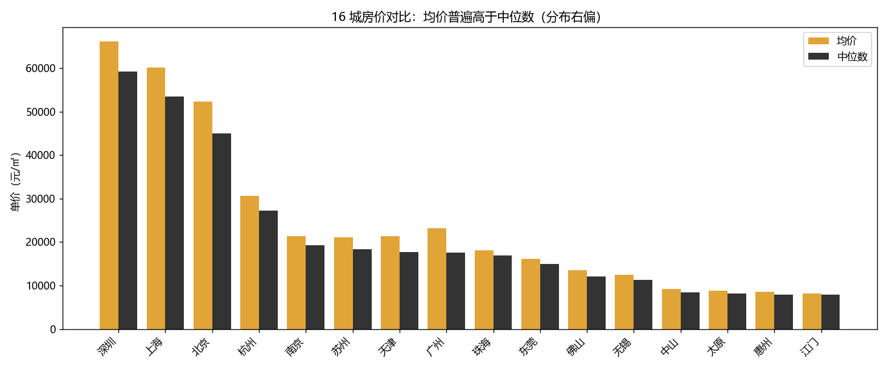
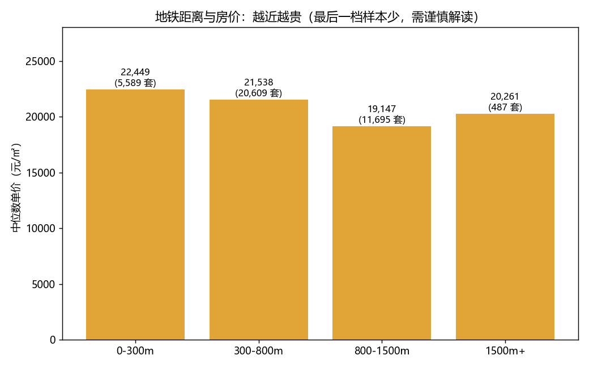
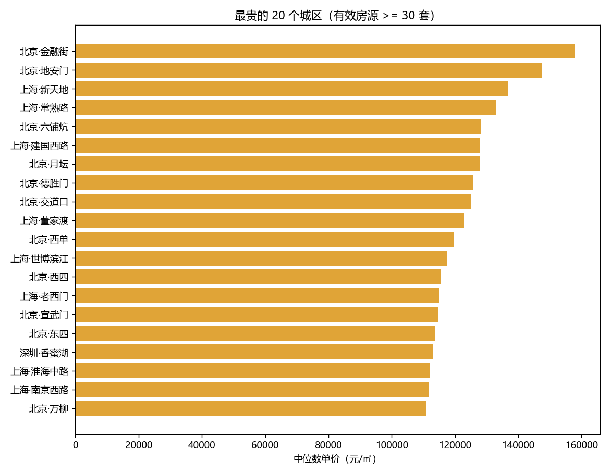
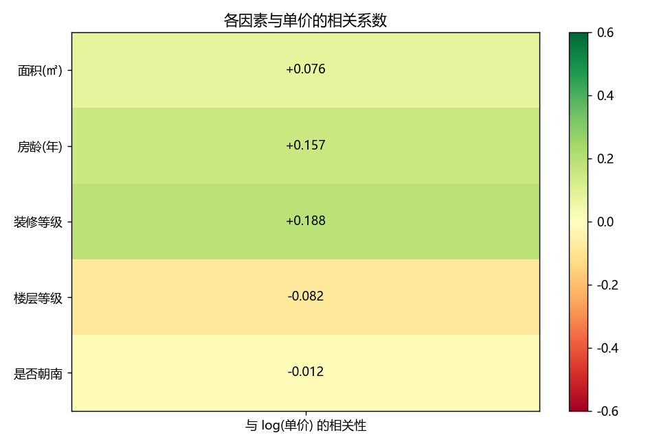
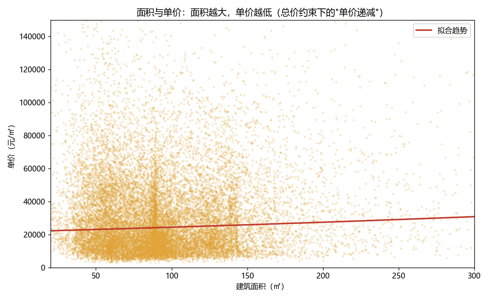
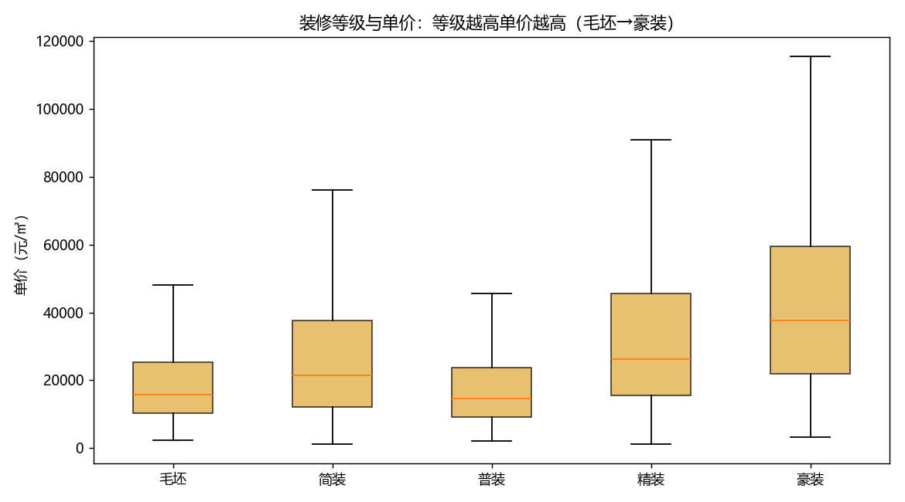

# 房价影响因素分析报告

对 16 个城市、45.5 万条二手房挂牌数据的分析：**房价由什么决定，以及哪些因素是"看起来相关、其实是混杂"**。

> 数据与方法代码见 [`analysis/`](../analysis/)、[`etl/`](../etl/)、[`sql/`](../sql/)；数据质量报告见 [data-quality.md](./data-quality.md)。

## 一、数据与方法

| 项 | 说明 |
|---|---|
| 数据来源 | Kaggle 公开数据集 `xiaopaohadoop/second-housing-dataset`（不使用爬虫，规避合规风险） |
| 规模 | 原始 **455,566 行 × 22 列**；通过质量校验 **449,117 行（98.6%）** |
| 覆盖 | **16 个城市**、1,106 个城区 |
| 加工链路 | ODS（原样落库）→ DWD（清洗 + 派生）→ DWS（聚合） |
| 工具 | MySQL 8.0（窗口函数）、Python（pandas / numpy / matplotlib） |

**关键方法**：

1. **中位数而非平均数**：房价分布右偏（少数豪宅拉高均值），所以每个聚合指标都同时给出两者。
   MySQL 无 `PERCENTILE_CONT`，用窗口函数 `CUME_DIST()` 求中位数（累计分布首次跨过 0.5 的值）。
2. **标准化回归**：自变量做 z-score 标准化后回归，系数（β）之间才可直接比较"影响强弱"。
3. **因变量取对数**：`log10(单价)`，让右偏的单价更接近正态，回归更稳。
4. **地铁距离单独分析**：该字段缺失率 91.5%，放进回归会丢掉九成样本，改用分档对比。

## 二、四个核心发现

### 1. 城市分层：中位数单价相差 7.5 倍



| 城市 | 有效房源 | 均价 | 中位数 | 均值/中位数 |
|---|---|---|---|---|
| 深圳 | 2,013 | 66,106 | **59,203** | 1.117 |
| 上海 | 66,118 | 60,143 | **53,536** | 1.123 |
| 北京 | 73,441 | 52,345 | **44,943** | 1.165 |
| 杭州 | 73,378 | 30,575 | 27,292 | 1.120 |
| 南京 | 40,784 | 21,420 | 19,266 | 1.112 |
| 苏州 | 59,928 | 21,154 | 18,420 | 1.148 |
| 天津 | 72,638 | 21,417 | 17,715 | 1.209 |
| 广州 | 2,005 | 23,156 | 17,568 | **1.318** |
| … | | | | |
| 太原 | 43,879 | 8,787 | 8,133 | 1.080 |
| 江门 | 1,995 | 8,186 | **7,891** | 1.037 |

**深圳中位数（59,203）是江门（7,891）的 7.5 倍。**

### 2. 均值普遍高于中位数：房价分布普遍右偏

16 城的 **均值/中位数比值在 1.04–1.32** 之间。**广州最高（1.318）**：均值 23,156 而中位数仅 17,568。

> 如果只看均价，会以为广州房价与南京（21,420）接近；实际上广州典型房源（中位数 17,568）比南京（19,266）还低。
> **这就是"为什么用中位数"的直接证据。**

### 3. 地铁溢价：0–300m 比 800–1500m 高 17.2%



| 地铁距离 | 有效房源 | 均价 | 中位数 |
|---|---|---|---|
| **0–300m** | 5,589 | 27,728 | **22,449** |
| 300–800m | 20,609 | 25,625 | 21,538 |
| 800–1500m | 11,695 | 22,628 | **19,147** |
| 1500m+ | **487** ⚠️ | 25,867 | 20,261 |

**0–300m 的中位数比 800–1500m 高 17.2%。** 这一档距离是从**非结构化文本**（`subway_info`）中正则提取的，解析成功率 99.9%。

⚠️ 最后一档反弹（1500m+ 中位数 20,261），但样本仅 487 条，很可能是远郊大户型/别墅类房源带来的偏差，**不能作为"越远越贵"的结论**。

### 4. 城区差异：最贵 20 个城区被京沪包揽



| 排名 | 城区 | 中位数单价 | 有效房源 |
|---|---|---|---|
| 1 | 北京 **金融街** | **157,895** | 371 |
| 2 | 北京 地安门 | 147,465 | 31 |
| 3 | 上海 新天地 | 136,835 | 176 |
| 4 | 上海 常熟路 | 132,895 | 72 |
| 5 | 北京 六铺炕 | 128,171 | 228 |

（城区聚合设了"有效房源 ≥ 30 套"的门槛，避免小样本拉出离谱均价。）

## 三、房屋自身属性的影响（回归分析）



标准化回归（因变量 `log10(单价)`，样本 428,142 行）：

| 因素 | β（标准化） | 方向 | 相关系数 r |
|---|---|---|---|
| 房龄 | **+0.0798** | 正向 ⚠️ | +0.157 |
| 装修等级 | **+0.0685** | 正向 | +0.188 |
| 面积 | +0.0450 | 正向 | +0.076 |
| 楼层等级 | −0.0297 | 负向 | −0.082 |
| 是否朝南 | −0.0051 | 几乎无影响 | −0.012 |

**R² = 0.096** —— 房屋自身属性只能解释约 **10%** 的单价差异。



### 装修等级：整体递增，但有一个异常点



| 装修 | 中位数单价 | 套数 |
|---|---|---|
| 毛坯 | 15,888 | 25,853 |
| 简装 | 21,418 | 129,049 |
| **普装** | **14,621** ⚠️ | **3,334** |
| 精装 | 26,157 | 281,422 |
| 豪装 | **37,540** | 9,459 |

## 四、三个"反直觉"现象及正确解读

| 现象 | 表面结论 | 正确解读 |
|---|---|---|
| 普装（14,621）比毛坯（15,888）还低 | "普装不如毛坯" | **混杂因素**：普装样本仅 3,334 套且集中在低房价城市。应分城市比较或加城市固定效应 |
| 房龄 **正向**（β = +0.0798） | "房子越老越贵" | **代理变量**：老房子集中在市中心（地段好），新房多在郊区。房龄在此"代理"了地段 |
| R² 仅 **0.096** | "模型很差" | **模型边界**：说明决定性因素是**城市与地段**，而非房屋自身属性——与第一部分"城市间差 7.5 倍"完全吻合 |

**这三条比"R² 很高"更有价值**：它们说明分析者能识别混杂、代理变量，并清楚模型能解释什么、不能解释什么。

## 五、结论

1. **决定房价的首要因素是城市，其次是城区（地段）**，房屋自身属性（面积/房龄/装修/楼层/朝向）加起来只能解释约 10% 的差异。
2. **地铁距离是可量化的溢价因子**：0–300m 相对 800–1500m 高约 17%。
3. **指标口径很重要**：房价普遍右偏（均值比中位数高 4%–32%），衡量"典型房源"必须用中位数。

## 六、局限

1. **数据是挂牌价、不是成交价**，且为公开数据集，存在采集时点与城市覆盖不均的问题（广州/深圳样本仅约 2,000 条）。
2. **未纳入关键因素**：学区、商圈等级、楼层朝向的组合效应、房屋类型（住宅/别墅）。
3. **未控制混杂**：理想做法是**分城市分别回归**或加入城市固定效应，观察同一城市内各因素的纯效应。
4. **回归是相关性分析**，不能作为因果解释。

## 七、如何复现

```bash
# 1) 准备数据（Kaggle 公开数据集，无需登录）
mkdir -p data && cd data
curl -L -o sh-house.zip "https://www.kaggle.com/api/v1/datasets/download/xiaopaohadoop/second-housing-dataset"
unzip sh-house.zip && cd ..

# 2) 配置 MySQL 连接
cp .env.example .env    # 填写 MYSQL_PASSWORD

# 3) 跑完整链路：ODS -> DWD -> DWS -> 分析
python etl/load_ods.py        # 455,566 行原样入库
python etl/clean_dwd.py       # 清洗 + 派生字段 + 质量报告
python etl/build_dws.py       # 三张聚合表
python analysis/factor_analysis.py   # 6 张图表 + 回归结论
```
